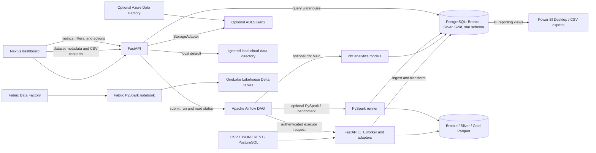

# DataFlow360

> An end-to-end enterprise data engineering platform featuring automated ETL
> pipelines, Apache Airflow orchestration, medallion architecture, PostgreSQL
> data warehousing, data quality monitoring, and interactive business analytics.

DataFlow360 is a retail data-engineering portfolio project. It demonstrates
how synthetic transactions can be ingested, validated, transformed,
orchestrated, stored in a PostgreSQL warehouse, and exposed to analytics
through a backend-driven dashboard.

The project is intended to make data quality, incremental loading, warehouse
grain, lineage, and optional platform integrations visible in one reproducible
local workflow. It is not a production-deployed enterprise service. The
development Compose stack uses local credentials and an Airflow debug
webserver; external cloud services and Power BI Desktop are unverified.

## Contents

- [Features and data lifecycle](#features-and-data-lifecycle)
- [Technology stack](#technology-stack)
- [Architecture](#architecture)
- [Run locally](#run-from-a-fresh-checkout)
- [Testing and CI/CD](#testing-and-checks)
- [Portfolio deployment](#portfolio-deployment)
- [Power BI reporting](#optional-power-bi-reporting)
- [Verification and known limitations](#verification-status-and-known-limitations)
- [Documentation map](#documentation-map)

## Business problem and objectives

Retail transaction sources may contain duplicates, missing values, invalid
quantities, malformed prices, or schema changes. The project demonstrates a
repeatable path to detect and quarantine these cases, load accepted data at a
well-defined grain, preserve analytical history, and provide database-backed
reporting.

Objectives:

- Keep ingestion, transformations, and warehouse updates repeatable.
- Make data quality outcomes and execution state observable.
- Preserve legitimate order lines and prevent duplicate warehouse records.
- Keep optional processing/cloud/BI integrations separate from local mode.
- Document which integrations were actually run and which remain design assets.

## Features and data lifecycle

1. **Ingest:** local CSV, JSON, REST, and PostgreSQL adapters; optional ADLS
   adapter and ADF templates.
2. **Validate:** configurable quality checks, schema drift observations, and
   rejected-row quarantine.
3. **Transform:** normalize rows and calculate revenue without inventing cost
   or margin data.
4. **Load:** persist Bronze/Silver/Gold and star-schema facts in PostgreSQL
   using the `(order_id, line_number)` sales grain.
5. **Orchestrate:** queue actual Airflow DAG runs, execute work asynchronously,
   and poll actual DAG/task states.
6. **Analyze:** optional dbt marts, full-snapshot Parquet outputs, reporting
   views, CSV exports, and Power BI source assets.
7. **Observe:** Next.js pages read API/database metrics and persisted run,
   quality, inventory, and processing results.

### Technology stack

| Area | Technology |
|---|---|
| API and ETL | Python 3.12, FastAPI, Pandas |
| Frontend | Next.js 15, React 19, TypeScript |
| Warehouse | PostgreSQL 16, SQL, star schema |
| Orchestration | Apache Airflow 2.10.5 |
| Analytics | dbt Core 1.12.7, dbt-postgres 1.11.0 |
| Optional distributed processing | Java 17, PySpark 3.5.6 |
| File format | Parquet via PyArrow |
| Local infrastructure | Docker Compose |
| Optional integration assets | Azure Data Lake Gen2, Azure Data Factory, Fabric, Power BI |

Version values above reflect previously verified local runs, not a guarantee
that every optional service is running in a new checkout.

Screenshots are not included. The capture status and page checklist are in
[docs/screenshots](docs/screenshots/README.md).

## Architecture



For detailed ETL, medallion, warehouse, Airflow, dbt, Spark, data-quality,
cloud, Power BI, and CI/CD diagrams, see [architecture documentation](docs/architecture.md).

## Repository structure

```text
backend/                 FastAPI API, ETL, adapters, tests
frontend/                Next.js dashboard and standalone Docker build
warehouse/               PostgreSQL initialization SQL and migrations
airflow/dags/             Airflow DAG
dbt/                      dbt models, seeds, and tests
spark/                    Optional Spark runner and equivalence tests
azure/                    ADLS adapter support, ADF templates, Fabric notebook
powerbi/                  M queries, DAX, semantic model, report designs, theme
scripts/                  Reproducible synthetic data generator
docs/                     Architecture, setup, operations, and portfolio guides
.github/workflows/        CI, security, Docker, optional integration, release
compose.deploy.yml        Lightweight demonstration stack
```

The small `data/sales.csv` fixture is tracked. The 50,000-row generated CSV and
JSON files and runtime Parquet outputs are excluded; keep
`scripts/generate_synthetic_data.py` to regenerate the scale-test inputs.

## Run from a fresh checkout

Requirements: Docker Desktop, Node.js 22+, and npm.

```powershell
cd C:\path\to\DataFlow360
Copy-Item .env.example .env
# Replace the placeholder values in .env with local development credentials.
docker compose up --build -d
cd frontend
npm ci
npm run dev
```

Services:

- Dashboard: http://localhost:3000
- API docs: http://localhost:8000/docs
- Airflow UI: http://localhost:8080 (username and password from `.env`)
- PostgreSQL: `localhost:5432`

Compose starts PostgreSQL, backend, and Airflow services. Optional profiles
enable dbt and Spark:

```powershell
docker compose --profile dbt up --build -d
docker compose --profile spark up --build -d
```

The one-time
`airflow-init` container migrates Airflow metadata before the webserver and
scheduler start. The backend applies checked-in warehouse SQL and migrations on
startup. Existing named PostgreSQL volumes are retained by normal `up` and
`down` commands; do not use `down -v` if you need to preserve local data.

## Implemented pipeline flow

1. `POST /pipeline/run` asks the Airflow REST API to create a DAG run and returns
   HTTP 202 with its real `dag_run_id`. Airflow API failures are surfaced; there
   is no direct-execution success fallback.
2. The Airflow task calls the authenticated internal `/pipeline/execute`
   endpoint. The long-running load executes in the Airflow worker, not in the
   user-facing trigger request.
3. `GET /pipeline/runs/{dag_run_id}` retrieves the current DAG and task states
   from Airflow. The `/airflow` page polls this endpoint and renders those
   states.
4. Successful loads upsert Bronze, Silver, dimensions, and Gold in PostgreSQL,
   then atomically replace the corresponding Parquet snapshots in the mounted
   `data/parquet/` directory.
5. Silver and Gold use `(order_id, line_number)` grain. Repeated order IDs with
   different line numbers are separate sale lines; repeated line keys are
   rejected. Updated line values propagate to Gold and its aggregates.

The local CSV and JSON files are in `data/`. Regenerate the 12-month synthetic
dataset from the project root with:

```powershell
docker compose exec backend python /app/scripts/generate_synthetic_data.py --records 50000
```

Supported base dataset sizes are `50000`, `100000`, `500000`, and `1000000`.
Larger files are generated only when explicitly requested. Each size adds
controlled missing, duplicate, malformed-price, and invalid-quantity records:

```powershell
docker compose exec backend python /app/scripts/generate_synthetic_data.py --records 100000
```

This step is required before running the scaled CSV/JSON pipeline or the
scaled-dataset tests from a fresh checkout. Regenerating data does not ingest it;
queue a run from the Sources page or use:

```powershell
curl.exe -X POST "http://localhost:8000/pipeline/run?source=csv&incremental=false"
```

Adapters available via `source=csv|json|rest|postgres`. REST reads the local
sample API; PostgreSQL reads Silver. Parquet outputs are
`data/parquet/bronze_sales.parquet`, `silver_sales.parquet`, and
`gold_sales.parquet`.

## API endpoints

- `GET /health`, `GET /overview`, `GET /analytics`
- `GET /quality`, `GET /medallion`, `GET /dimensions`, `GET /inventory`
- `GET /adapters`, `GET /adapters/rest/sample`
- `POST /pipeline/run?source=csv&incremental=true` (asynchronous Airflow trigger)
- `POST /pipeline/run?source=csv&engine=pyspark` (optional Spark profile)
- `POST /processing/benchmark` (Pandas/PySpark result-equivalence benchmark)
- `GET /processing`, `GET /lineage`
- `GET /pipeline/runs/{dag_run_id}` (actual Airflow run/task states)
- `POST /pipeline/execute` (internal token required; called by Airflow only)
- `GET /cloud/status`, `GET /cloud/history`
- `POST /cloud/storage/test`, `POST /cloud/sync`
- `GET /cloud/storage/files/{layer}` and
  `GET /cloud/storage/files/{layer}/{object_name}` (configured storage adapter)
- `GET /bi/datasets`, `GET /bi/model`
- `GET /bi/exports/{dataset}.csv` (streamed reporting-view CSV)

The dashboard has eleven pages: Overview, Sources, Data Quality, Medallion,
Star Schema, Analytics, Inventory, Processing, Airflow, Cloud Integration,
and Business Intelligence.
Analytics filters
are sent to the backend rather than computed from browser-side demo values.
The Processing page reads engine availability and persisted execution metrics
from the backend and can submit real Airflow requests for Pandas, optional
PySpark, and an equivalence benchmark.

The Cloud Integration page shows actual backend storage status, connection
results, sync history, and stored file listings. Fabric labels are
configuration-only and always remain unverified until run in a real workspace.
The Business Intelligence page reads reporting-view row counts, available dbt
models, revenue totals, refresh timestamps, and semantic-model metadata from
the backend. It downloads CSVs from those same database views; it is not an
embedded Power BI report.

## Optional Power BI reporting

- The PostgreSQL `bi` schema exposes conformed sales, inventory, customer,
  product, date, region, supplier, pipeline, processing, and data-quality
  reporting views. Gold remains the primary source of truth; dbt marts in
  `analytics` are optional and are listed only when present.
- `powerbi/power-query/` contains parameterized PostgreSQL/CSV M queries,
  dimension/fact queries, and examples for incremental filtering, grouping,
  merging, and appending partitioned sources.
- `powerbi/dax/` contains 35 measures based only on available warehouse and
  execution fields. No profit, margin, cost, or forecast measure is invented.
- `powerbi/semantic-model/`, `powerbi/reports/`, and
  `powerbi/themes/dataflow360-theme.json` provide the star-schema guide, data
  dictionary, five report page specifications, and theme.
- Setup, manual refresh, and limitations are documented in
  [Power BI guide](docs/powerbi-guide.md),
  [Power Query](docs/power-query.md),
  [DAX measures](docs/dax-measures.md),
  [semantic model](docs/semantic-model.md), and
  [Business Intelligence](docs/business-intelligence.md).
- No PBIX/PBIP file or database snapshot is included. Power BI Desktop was not
  found in the checked install paths, so Power Query execution, DAX
  evaluation, DirectQuery, refresh, and report rendering remain unverified.

## CI/CD architecture

Pull requests and pushes to `main` and `feature/**` have workflows for backend
and isolated-PostgreSQL tests, frontend type/build checks, ETL/dbt checks,
Docker validation, and dependency/secret scans. Airflow DAG import and small
PySpark equivalence checks are manual to avoid heavyweight integrations on
every commit. Version tags trigger release validation and Docker build
verification; GHCR publishing requires a separate manual opt-in. No automatic
deployment is configured. See [CI/CD guide](docs/ci-cd-guide.md).

## Documentation map

- [Architecture diagrams](docs/architecture.md)
- [Deployment guide](docs/deployment-guide.md)
- [CI/CD guide](docs/ci-cd-guide.md)
- [Security notes](docs/security.md)
- [Testing guide](docs/testing.md)
- [Troubleshooting](docs/troubleshooting.md)
- [Demo guide](docs/demo-guide.md)
- [Project limitations](docs/project-limitations.md)
- [Interview guide](docs/interview-guide.md)
- [Portfolio materials](docs/portfolio.md)
- [Screenshot checklist](docs/screenshots/README.md)

## Optional Azure and Microsoft Fabric

- The `StorageAdapter` defaults to local storage under ignored `data/cloud/`.
  Azure mode uses the Azure Python SDK and Microsoft Entra
  `DefaultAzureCredential`; no account key or SAS credential is supported.
- The backend reports actual configuration, test, sync, listing, and operation
  history responses. Cloud connection results are not faked. Sync copies the
  existing three Parquet snapshots to pre-created Bronze/Silver/Gold ADLS file
  systems; it does not create resources or run automatically.
- `azure/data-factory/` contains parameterized native ADF templates for CSV,
  JSON, REST, and PostgreSQL ingestion, plus PostgreSQL watermark SQL and a
  stopped schedule trigger. Deploy only to an existing factory after filling
  non-secret endpoint values and configuring identity permissions.
- `azure/fabric/dataflow360_medallion.ipynb` demonstrates OneLake Lakehouse
  Delta Bronze/Silver/Gold processing, data-quality quarantine, MERGE-based
  incremental updates, and business aggregates. It must be imported and run in
  a real Fabric workspace; local Spark is not a substitute.
- Azure and Fabric setup, identity/permission guidance, deployment instructions,
  architecture, costs, cleanup, and limitations are documented in
  [Azure setup](docs/azure-guide.md),
  [ADF templates](docs/azure-data-factory.md),
  [Fabric setup](docs/fabric-guide.md),
  [cloud architecture](docs/cloud-architecture.md), and
  [cloud cost management](docs/cloud-cost-management.md).

Azure configuration variables are listed in `.env.example`. The default
`CLOUD_STORAGE_MODE=local` preserves local behavior. Install optional SDK
dependencies with `python -m pip install -r backend/requirements-azure.txt`;
for Docker builds set `INSTALL_AZURE_SDK=true` before building the backend.
Credentials belong only in the ignored `.env` or a managed identity—not in
source files.

## Optional dbt and Spark

- dbt reads the existing PostgreSQL Silver, dimensions, and inventory tables
  and builds analytics-schema models. See [docs/dbt-guide.md](docs/dbt-guide.md).
- PySpark runs only in the optional `spark` Compose profile and writes
  run-correlated Bronze, Silver, rejected, and Gold Parquet outputs. See
  [docs/spark-guide.md](docs/spark-guide.md).
- Benchmark results are persisted and displayed only after real runs; no
  performance advantage is claimed without measurements. See
  [docs/benchmark-results.md](docs/benchmark-results.md).
- Quality rules, thresholds, quarantine, schema drift, and lineage are
  described in [docs/data-quality.md](docs/data-quality.md) and
  [docs/pipeline-recovery.md](docs/pipeline-recovery.md). SQL examples are in
  [docs/sql-examples.md](docs/sql-examples.md).

## Tests and checks

```powershell
docker compose exec backend python /app/scripts/generate_synthetic_data.py --records 50000
docker compose exec backend python -m unittest discover -s tests
Set-Location frontend
npm ci
npm run typecheck
npm run build
```

For a small fixture without writing into the tracked sample-data directory:

```powershell
python scripts/generate_synthetic_data.py --records 100 --output-dir $env:TEMP\dataflow-fixture
```

GitHub Actions definitions cover backend tests against isolated PostgreSQL,
frontend type/build checks, ETL/data-quality/upsert checks, dbt parse/build,
Compose validation, image builds, and security scans. Airflow DAG import and
small Spark checks are manual workflows. Workflows are locally configured but
have not yet been verified by a remote GitHub Actions run on this branch.
Details: [CI/CD guide](docs/ci-cd-guide.md) and [testing guide](docs/testing.md).

## Portfolio deployment

[`compose.deploy.yml`](compose.deploy.yml) runs only the frontend, API, and
PostgreSQL, with persistent named volumes for PostgreSQL, Parquet, and local
cloud-adapter data. It binds web/API ports to loopback by default and does not
publish PostgreSQL. TLS, a reverse proxy, authentication gateway, backup
automation, and monitoring must be configured separately.

```powershell
Copy-Item .env.deploy.example .env.deploy
# Replace all secrets and example origins before use.
docker compose --env-file .env.deploy -f compose.deploy.yml config --quiet
docker compose --env-file .env.deploy -f compose.deploy.yml up --build -d
```

This is a portfolio demonstration configuration, not a production deployment.
See [deployment guide](docs/deployment-guide.md) and [security notes](docs/security.md).

Useful checks:

```powershell
curl.exe http://localhost:8000/health
curl.exe http://localhost:8080/health
curl.exe "http://localhost:8000/analytics?region=North"
docker compose exec db psql -U dataflow -d dataflow -c "select count(*) from silver_sales;"
```

## Verification status and known limitations

- Previously verified v0.3 local results: the backend suite passed **21 tests**,
  including the PostgreSQL Gold upsert integration test; the frontend
  production build/type check passed; Docker Compose validation passed; and all
  nine pre-cloud dashboard routes returned HTTP 200.
- dbt 1.8.8 / adapter 1.8.2: `dbt debug` passed, `dbt build` passed **41/41**,
  `dbt test` passed **19/19**, and docs generation succeeded. Incremental
  insert/update and idempotency checks passed. These commands were run
  separately; the optional Airflow dbt task remains disabled by default.
- Spark: Java 17 and Spark/PySpark 3.5.6 were verified. The 50,000-row
  equivalence benchmark passed. The recorded runs processed 52,750 rows
  (50,000 accepted, 2,750 rejected): Pandas completed in 5.71s
  (9,236 rows/s) and PySpark in 91.63s (576 rows/s). These are local,
  environment-specific measurements; PySpark was slower in this benchmark.
- Airflow: a real full ETL DAG run succeeded after retry, reading 52,750 rows
  and accepting 50,000 while rejecting 2,750; backend status polling returned
  actual task states. The downstream `dbt_build` task was skipped because
  `DBT_ENABLED` is false. Local runs currently use Airflow's `webserver
  --debug` mode after the standard Gunicorn startup exceeded its timeout; the
  underlying Gunicorn startup cause remains unresolved, so this is not a
  production webserver configuration.
- The current verified PostgreSQL layer counts are 155,603 Bronze,
  50,002 Silver, and 50,002 Gold rows. The two extra Silver/Gold rows are
  existing records; the latest full run itself accepted 50,000 rows. The
  `quantity_range` rule allows a 2% fixture failure rate; the observed 750 of
  52,750 rows (1.4218%) passed that configured threshold.
- Phase 13 added eleven `bi` reporting views plus optional dbt model
  discovery and CSV export endpoints. In the verified local database,
  `bi.fact_sales` and `analytics.fct_sales_line` each contained 50,002 lines
  and reconciled to revenue **114,850,077.34**; inventory contained 3,024
  rows, persisted processing executions 4, data-quality results 55, and
  quality summaries 5. Migration `006_business_intelligence.sql` was applied.
  The focused BI regression tests passed **4/4**; frontend TypeScript
  validation and production build passed. The build generated all eleven
  application routes.
- Power BI source assets include **16** Power Query files, **35** DAX
  measures, semantic-model/report specifications, and a theme. These source
  files have not been evaluated by Power BI Desktop or a DAX/M engine.
- Parquet snapshots are full-table rewrites after each successful ETL run and
  can become expensive as data grows. CSV/JSON are local-file adapters; the
  REST and PostgreSQL adapters target local demonstration services.
- Phase 12 cloud source changes are not represented in the v0.3 verification
  numbers above. Azure adapter unit tests use mocked Azure clients; no real
  subscription, ADLS account, Data Factory, or Fabric workspace was connected.
  Migration `005_cloud_integration.sql` was applied to the existing PostgreSQL
  database and its table/indexes were verified. The focused backend-container
  cloud suite passed **12/12 tests**. Local API checks confirmed status,
  history, connection testing, synchronization, and Fabric/Azure unavailable
  states. The first Parquet copy exceeded the client's short request timeout
  but completed successfully in the backend; the follow-up synchronization
  returned `skipped` for all three unchanged files, whose SHA-256 hashes
  matched their source snapshots.
- TypeScript `tsc --noEmit`, Docker Compose configuration validation, all 12
  ADF JSON resource parses, and Fabric notebook JSON/Python syntax checks
  passed. The Cloud Integration page was served with HTTP 200 and browser
  inspection confirmed backend-derived local status, three dataset sizes,
  stored object listing, operation history, Azure unavailable, and Fabric
  not-configured/unrun status. The v0.4 production build compiled and passed
  type checking but timed out during page-data collection. The subsequent
  v0.5 production build completed successfully, including static generation
  and type validation; `/business-intelligence` returned HTTP 200 and browser
  inspection showed live backend values.
- The `/cloud/sync` endpoint only synchronizes the current Parquet layer
  snapshots. ADF templates require an existing configured factory, network
  access, Key Vault secrets, pre-created storage file systems, and database
  grants. The Fabric notebook requires a real Fabric Lakehouse; its execution
  remains unverified.
- The Airflow DAG has one ETL task and an optional downstream dbt task; it does
  not expose each ETL stage as a separate Airflow task. Backend stage-level
  execution metadata does not replace that DAG decomposition.
- `.env.example` contains placeholders. Keep local secrets in the ignored
  `.env`, never commit it, and use a secrets manager outside local development.
  Cloud resources were not deployed. Power BI Desktop, PBIX/PBIP creation,
  M/DAX execution, DirectQuery, refresh, and report rendering remain
  unverified.
- Phase 14 CI workflows and Phase 15 deployment assets in
  `feature/production-readiness` are source changes only until this branch is
  committed/published and GitHub executes its workflows. See
  [project limitations](docs/project-limitations.md); no production
  deployment or remote CI result is claimed.
