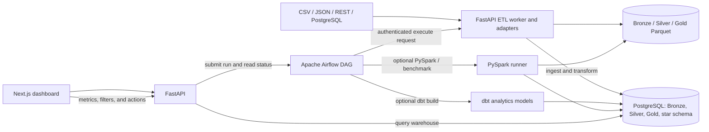

# DataFlow360 v0.3

> An end-to-end enterprise data engineering platform featuring automated ETL
> pipelines, Apache Airflow orchestration, medallion architecture, PostgreSQL
> data warehousing, data quality monitoring, and interactive business analytics.

Local retail data platform with a Next.js dashboard, FastAPI API, PostgreSQL
warehouse, Airflow orchestration, optional dbt and PySpark services, synthetic
transaction generator, quality monitoring, and Parquet persistence. The sample
dataset is synthetic. Compose uses development-only credentials and is not
production hardened.

Screenshots are not included yet.

## Architecture



The small `data/sales.csv` fixture is tracked. The 50,000-row generated CSV and
JSON files and runtime Parquet outputs are excluded; keep
`scripts/generate_synthetic_data.py` to regenerate the scale-test inputs.

## Run from a fresh checkout

Requirements: Docker Desktop, Node.js 22+, and npm.

```powershell
cd C:\path\to\DataFlow360
Copy-Item .env.example .env
# Replace the placeholder values in .env with local development credentials.
docker compose up --build -d
cd frontend
npm ci
npm run dev
```

Services:

- Dashboard: http://localhost:3000
- API docs: http://localhost:8000/docs
- Airflow UI: http://localhost:8080 (username and password from `.env`)
- PostgreSQL: `localhost:5432`

Compose starts PostgreSQL, backend, and Airflow services. Optional profiles
enable dbt and Spark:

```powershell
docker compose --profile dbt up --build -d
docker compose --profile spark up --build -d
```

The one-time
`airflow-init` container migrates Airflow metadata before the webserver and
scheduler start. The backend applies checked-in warehouse SQL and migrations on
startup. Existing named PostgreSQL volumes are retained by normal `up` and
`down` commands; do not use `down -v` if you need to preserve local data.

## Implemented pipeline flow

1. `POST /pipeline/run` asks the Airflow REST API to create a DAG run and returns
   HTTP 202 with its real `dag_run_id`. Airflow API failures are surfaced; there
   is no direct-execution success fallback.
2. The Airflow task calls the authenticated internal `/pipeline/execute`
   endpoint. The long-running load executes in the Airflow worker, not in the
   user-facing trigger request.
3. `GET /pipeline/runs/{dag_run_id}` retrieves the current DAG and task states
   from Airflow. The `/airflow` page polls this endpoint and renders those
   states.
4. Successful loads upsert Bronze, Silver, dimensions, and Gold in PostgreSQL,
   then atomically replace the corresponding Parquet snapshots in the mounted
   `data/parquet/` directory.
5. Silver and Gold use `(order_id, line_number)` grain. Repeated order IDs with
   different line numbers are separate sale lines; repeated line keys are
   rejected. Updated line values propagate to Gold and its aggregates.

The local CSV and JSON files are in `data/`. Regenerate the 12-month synthetic
dataset from the project root with:

```powershell
docker compose exec backend python /app/scripts/generate_synthetic_data.py --records 50000
```

Supported base dataset sizes are `50000`, `100000`, `500000`, and `1000000`.
Larger files are generated only when explicitly requested. Each size adds
controlled missing, duplicate, malformed-price, and invalid-quantity records:

```powershell
docker compose exec backend python /app/scripts/generate_synthetic_data.py --records 100000
```

This step is required before running the scaled CSV/JSON pipeline or the
scaled-dataset tests from a fresh checkout. Regenerating data does not ingest it;
queue a run from the Sources page or use:

```powershell
curl.exe -X POST "http://localhost:8000/pipeline/run?source=csv&incremental=false"
```

Adapters available via `source=csv|json|rest|postgres`. REST reads the local
sample API; PostgreSQL reads Silver. Parquet outputs are
`data/parquet/bronze_sales.parquet`, `silver_sales.parquet`, and
`gold_sales.parquet`.

## API endpoints

- `GET /health`, `GET /overview`, `GET /analytics`
- `GET /quality`, `GET /medallion`, `GET /dimensions`, `GET /inventory`
- `GET /adapters`, `GET /adapters/rest/sample`
- `POST /pipeline/run?source=csv&incremental=true` (asynchronous Airflow trigger)
- `POST /pipeline/run?source=csv&engine=pyspark` (optional Spark profile)
- `POST /processing/benchmark` (Pandas/PySpark result-equivalence benchmark)
- `GET /processing`, `GET /lineage`
- `GET /pipeline/runs/{dag_run_id}` (actual Airflow run/task states)
- `POST /pipeline/execute` (internal token required; called by Airflow only)

The dashboard has nine pages: Overview, Sources, Data Quality, Medallion,
Star Schema, Analytics, Inventory, Processing, and Airflow. Analytics filters
are sent to the backend rather than computed from browser-side demo values.
The Processing page reads engine availability and persisted execution metrics
from the backend and can submit real Airflow requests for Pandas, optional
PySpark, and an equivalence benchmark.

## Optional dbt and Spark

- dbt reads the existing PostgreSQL Silver, dimensions, and inventory tables
  and builds analytics-schema models. See [docs/dbt-guide.md](docs/dbt-guide.md).
- PySpark runs only in the optional `spark` Compose profile and writes
  run-correlated Bronze, Silver, rejected, and Gold Parquet outputs. See
  [docs/spark-guide.md](docs/spark-guide.md).
- Benchmark results are persisted and displayed only after real runs; no
  performance advantage is claimed without measurements. See
  [docs/benchmark-results.md](docs/benchmark-results.md).
- Quality rules, thresholds, quarantine, schema drift, and lineage are
  described in [docs/data-quality.md](docs/data-quality.md) and
  [docs/pipeline-recovery.md](docs/pipeline-recovery.md). SQL examples are in
  [docs/sql-examples.md](docs/sql-examples.md).

## Tests and checks

```powershell
docker compose exec backend python /app/scripts/generate_synthetic_data.py --records 50000
docker compose exec backend python -m unittest discover -s tests
cd frontend
npm run build
```

Useful checks:

```powershell
curl.exe http://localhost:8000/health
curl.exe http://localhost:8080/health
curl.exe "http://localhost:8000/analytics?region=North"
docker compose exec db psql -U dataflow -d dataflow -c "select count(*) from silver_sales;"
```

## Verification status and known limitations

- `.env.example` contains placeholders only. Copy it to `.env`, replace every
  placeholder, and never commit `.env` or use development credentials in a
  shared or production deployment.
- The internal pipeline token is configured locally through `.env`; use a
  secrets manager for non-local environments.
- Parquet snapshots are full-table rewrites after each successful ETL run and
  can become expensive as data grows.
- CSV/JSON are local-file adapters; the REST and PostgreSQL adapters target the
  local demonstration services.
- Airflow metadata initialization and PostgreSQL health checks previously
  succeeded, but the webserver exited during Gunicorn startup with `No response
  from gunicorn master`. The underlying Gunicorn startup cause remains
  unresolved. Live DAG triggering, status polling, retries, dbt orchestration,
  Spark execution, and end-to-end ETL are therefore not verified in this
  workspace. Inspect `docker compose logs airflow-webserver` before attempting
  any restart; database volumes are not part of this issue.
- The Airflow DAG currently has one ETL task and an optional downstream dbt
  task; it does not yet expose the ten ETL stages as separate Airflow tasks.
  Backend stage-level execution metadata does not replace that requested DAG
  task decomposition.
- The dbt image built and `dbt parse` passed with dbt 1.8.8 and adapter 1.8.2.
  Database-backed model builds, tests, incremental reruns, and docs generation
  have not been run. The Spark image build was stopped during the large PySpark
  package installation, so Spark execution and benchmark results are
  unverified. Database migrations and real orchestrated jobs also remain
  unverified in this workspace.
- The generated dataset includes controlled errors. Configurable quality
  thresholds permit expected fixture error rates; threshold failures retain
  Bronze/quarantine audit records and roll back warehouse changes without
  advancing the watermark.
- Cloud deployment and BI integrations are not part of this implementation.
