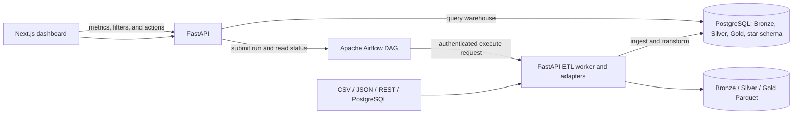

# DataFlow360

> An end-to-end enterprise data engineering platform featuring automated ETL
> pipelines, Apache Airflow orchestration, medallion architecture, PostgreSQL
> data warehousing, data quality monitoring, and interactive business analytics.

Local retail data platform with a Next.js dashboard, FastAPI API, PostgreSQL
warehouse, asynchronous Airflow orchestration, synthetic transaction generator,
and persisted Parquet snapshots. The sample dataset is synthetic. Compose uses
development-only credentials and is not production hardened.

Screenshots are not included yet.

## Architecture



The small `data/sales.csv` fixture is tracked. The 50,000-row generated CSV and
JSON files and runtime Parquet outputs are excluded; keep
`scripts/generate_synthetic_data.py` to regenerate the scale-test inputs.

## Run from a fresh checkout

Requirements: Docker Desktop, Node.js 22+, and npm.

```powershell
cd C:\path\to\DataFlow360
Copy-Item .env.example .env
# Replace the placeholder values in .env with local development credentials.
docker compose up --build -d
cd frontend
npm ci
npm run dev
```

Services:

- Dashboard: http://localhost:3000
- API docs: http://localhost:8000/docs
- Airflow UI: http://localhost:8080 (username and password from `.env`)
- PostgreSQL: `localhost:5432`

Compose starts PostgreSQL, backend, and Airflow services. The one-time
`airflow-init` container migrates Airflow metadata before the webserver and
scheduler start. The backend applies checked-in warehouse SQL and migrations on
startup. Existing named PostgreSQL volumes are retained by normal `up` and
`down` commands; do not use `down -v` if you need to preserve local data.

## Implemented pipeline flow

1. `POST /pipeline/run` asks the Airflow REST API to create a DAG run and returns
   HTTP 202 with its real `dag_run_id`. Airflow API failures are surfaced; there
   is no direct-execution success fallback.
2. The Airflow task calls the authenticated internal `/pipeline/execute`
   endpoint. The long-running load executes in the Airflow worker, not in the
   user-facing trigger request.
3. `GET /pipeline/runs/{dag_run_id}` retrieves the current DAG and task states
   from Airflow. The `/airflow` page polls this endpoint and renders those
   states.
4. Successful loads upsert Bronze, Silver, dimensions, and Gold in PostgreSQL,
   then atomically replace the corresponding Parquet snapshots in the mounted
   `data/parquet/` directory.
5. Silver and Gold use `(order_id, line_number)` grain. Repeated order IDs with
   different line numbers are separate sale lines; repeated line keys are
   rejected. Updated line values propagate to Gold and its aggregates.

The local CSV and JSON files are in `data/`. Regenerate the 12-month synthetic
dataset from the project root with:

```powershell
docker compose exec backend python /app/scripts/generate_synthetic_data.py
```

This step is required before running the scaled CSV/JSON pipeline or the
scaled-dataset tests from a fresh checkout. The generator creates 50,000 base
transactions and controlled missing,
duplicate, malformed, and invalid records. Regenerating data does not ingest it;
queue a run from the Sources page or use:

```powershell
curl.exe -X POST "http://localhost:8000/pipeline/run?source=csv&incremental=false"
```

Adapters available via `source=csv|json|rest|postgres`. REST reads the local
sample API; PostgreSQL reads Silver. Parquet outputs are
`data/parquet/bronze_sales.parquet`, `silver_sales.parquet`, and
`gold_sales.parquet`.

## API endpoints

- `GET /health`, `GET /overview`, `GET /analytics`
- `GET /quality`, `GET /dimensions`, `GET /inventory`
- `GET /adapters`, `GET /adapters/rest/sample`
- `POST /pipeline/run?source=csv&incremental=true` (asynchronous Airflow trigger)
- `GET /pipeline/runs/{dag_run_id}` (actual Airflow run/task states)
- `POST /pipeline/execute` (internal token required; called by Airflow only)

The dashboard has eight pages: Overview, Sources, Data Quality, Medallion,
Star Schema, Analytics, Inventory, and Airflow. Analytics filters are sent to
the backend rather than computed from browser-side demo values.

## Tests and checks

```powershell
docker compose exec backend python /app/scripts/generate_synthetic_data.py
docker compose exec backend python -m unittest discover -s tests
cd frontend
npm run build
```

Useful checks:

```powershell
curl.exe http://localhost:8000/health
curl.exe http://localhost:8080/health
curl.exe "http://localhost:8000/analytics?region=North"
docker compose exec db psql -U dataflow -d dataflow -c "select count(*) from silver_sales;"
```

## Known limitations

- `.env.example` contains placeholders only. Copy it to `.env`, replace every
  placeholder, and never commit `.env` or use development credentials in a
  shared or production deployment.
- The internal pipeline token is configured locally through `.env`; use a
  secrets manager for non-local environments.
- Parquet snapshots are full-table rewrites after each successful ETL run and
  can become expensive as data grows.
- CSV/JSON are local-file adapters; the REST and PostgreSQL adapters target the
  local demonstration services.
- Current workspace verification: Airflow metadata migration and PostgreSQL
  health checks succeed, but the webserver exits during Gunicorn startup with
  `No response from gunicorn master`. Consequently, `/pipeline/run` returns
  HTTP 503 and live DAG triggering/status polling are not currently verified.
  Inspect `docker compose logs airflow-webserver` before attempting any restart;
  database volumes are not part of this issue.
- The `dbt/` and `spark/` directories are not integrated into the active ETL
  workflow and have not been validated as supported execution paths.
- Cloud deployment and BI integrations are not part of this implementation.
