# DataFlow360 architecture

This describes the checked-in implementation. Azure Data Factory and Fabric
components are deployment assets, not live integrations. The dashboard reads
the FastAPI service; PostgreSQL is the operational and analytical source of
truth.

## 1. Overall system

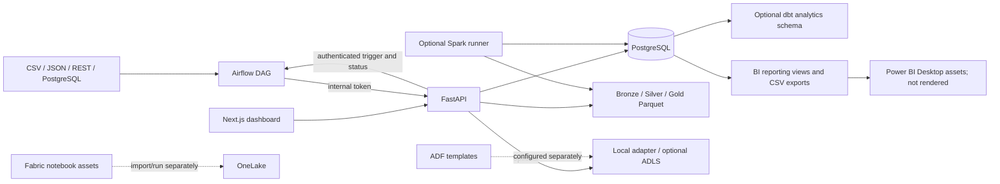

## 2. ETL flow

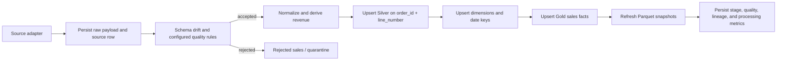

## 3. Medallion layers

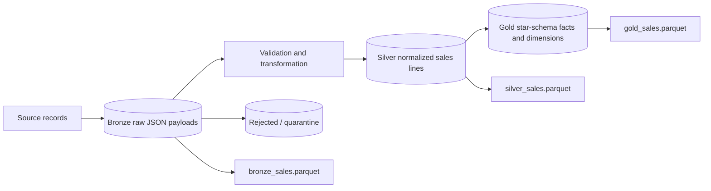

The database and Parquet outputs are both persisted. A successful ETL execution
publishes current full-table Parquet snapshots; these are not partitioned
incremental files.

## 4. PostgreSQL warehouse star schema

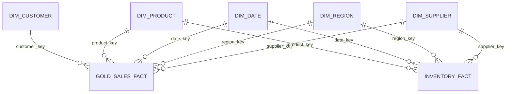

Sales grain is `(order_id, line_number)`. Inventory is one record per
`(product_key, date_key)`. The optional BI relationship design is documented
in [`../powerbi/semantic-model/star-schema.md`](../powerbi/semantic-model/star-schema.md).

## 5. Airflow and backend execution

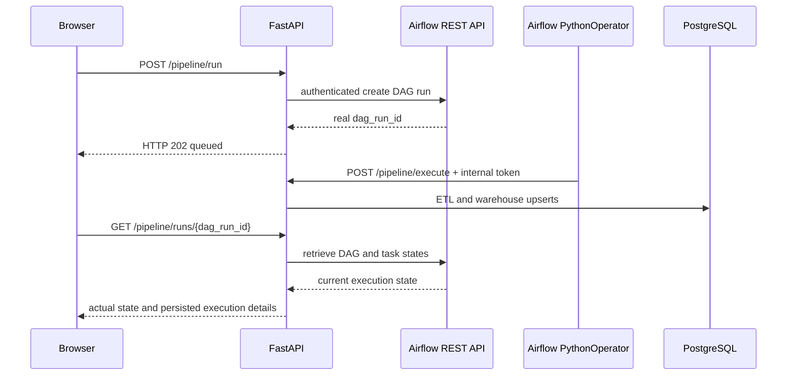

The DAG contains one ETL task and an optional downstream dbt task; ETL stages
are persisted in PostgreSQL but are not individual Airflow tasks.

## 6. dbt lineage

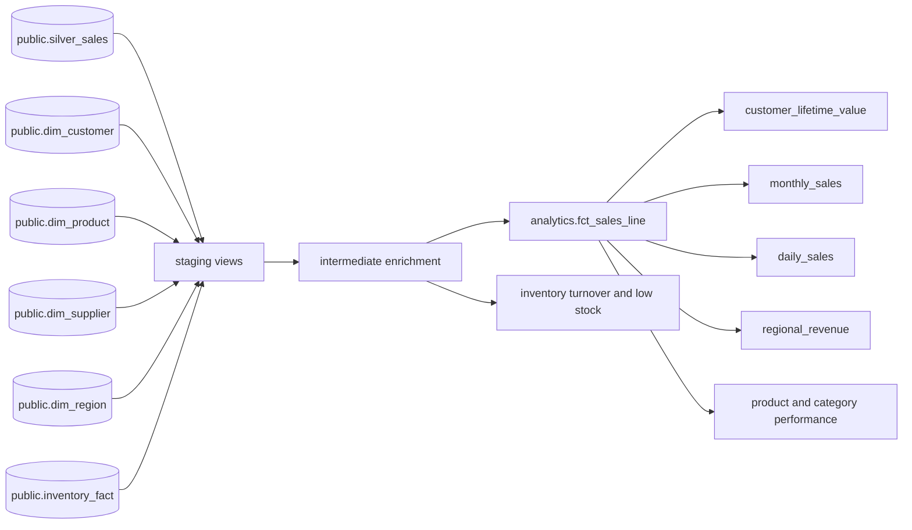

## 7. Pandas and Spark processing

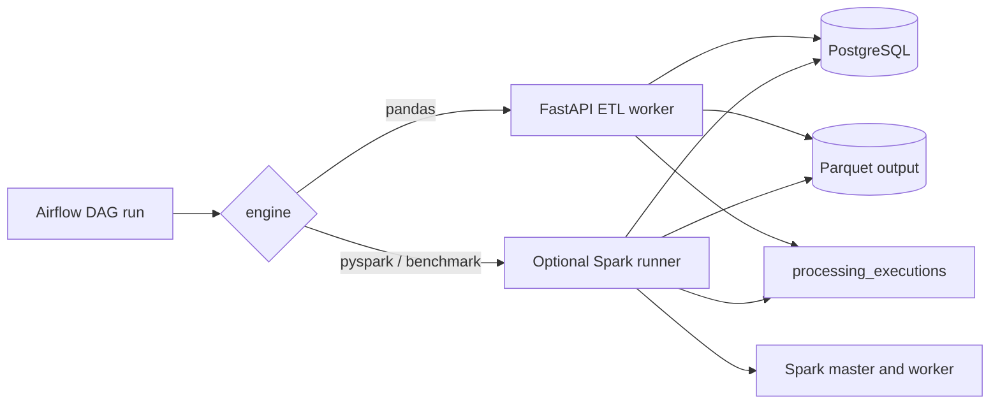

Spark is an optional profile. The previously recorded local 50k equivalence
benchmark was slower on PySpark than Pandas; see
[`benchmark-results.md`](./benchmark-results.md).

## 8. Data quality and quarantine

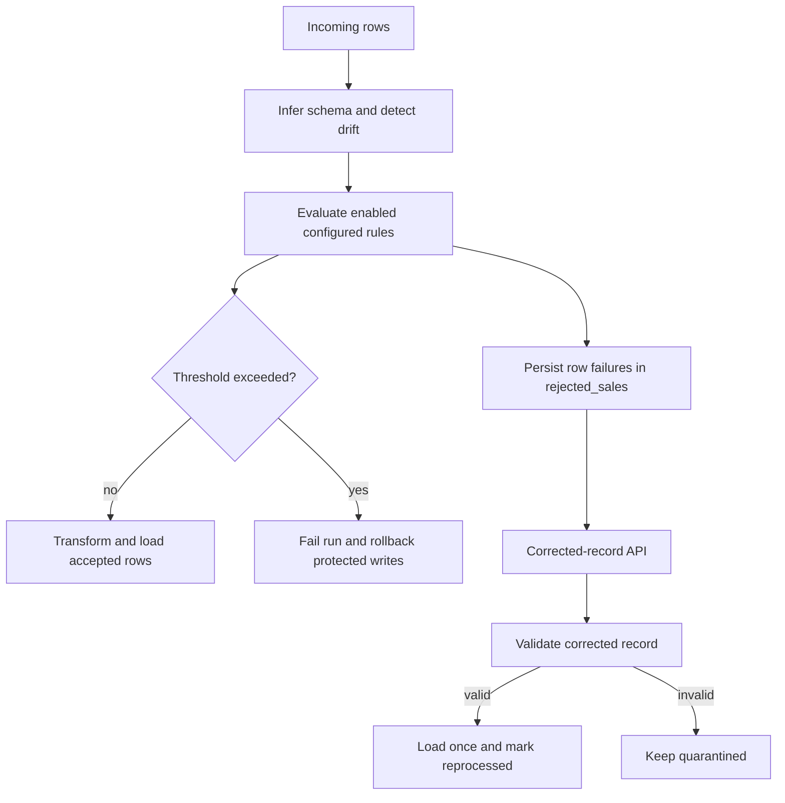

## 9. Optional Azure and Fabric

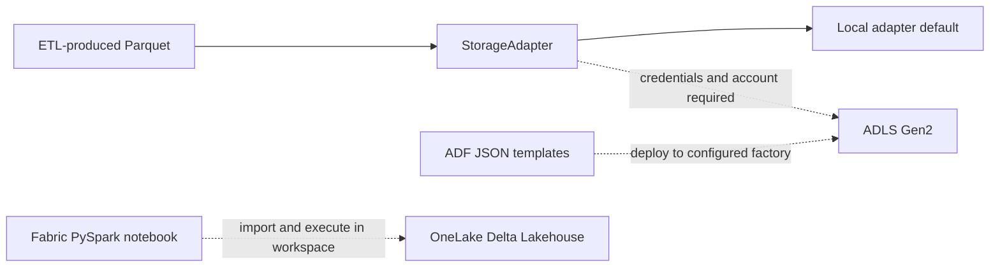

The Azure SDK integration, templates, and notebook have local source/test
coverage, but no real subscription, ADF factory, or Fabric workspace has been
connected for this release.

## 10. Power BI semantic model

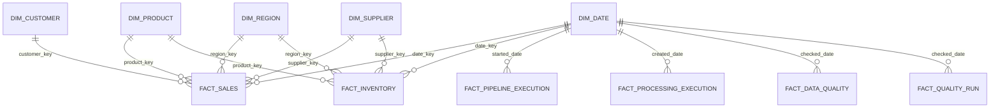

Power BI Desktop, PBIX/PBIP, M/DAX evaluation, DirectQuery, and report
rendering remain unverified.

## 11. CI/CD

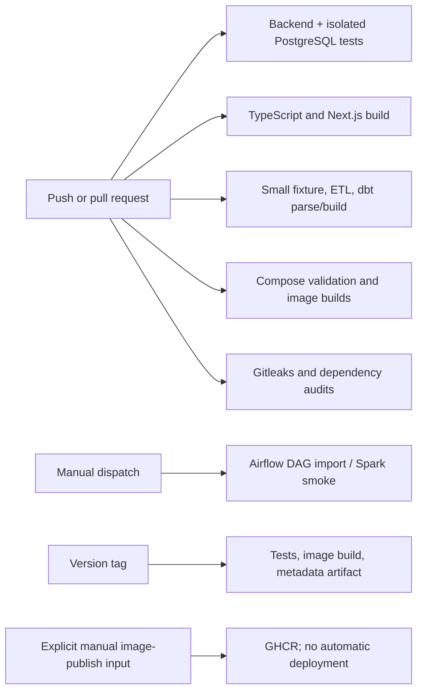

GitHub Actions definitions are locally authored but have not yet executed on
GitHub for this branch.
