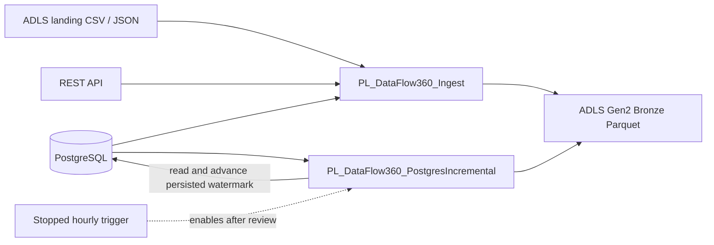

# Azure Data Factory templates

The checked-in assets under `azure/data-factory/` are deployable native ADF
resources for an **existing** factory. They include ADLS Gen2, Key Vault,
PostgreSQL V2, and REST linked services; CSV, JSON, REST, and PostgreSQL source
datasets; a parameterized ingestion pipeline; an incremental PostgreSQL
pipeline; and a stopped hourly schedule trigger. They are templates, not
evidence of a successful Azure deployment or run.



## Prerequisites

- An Azure subscription, resource group, and existing Azure Data Factory.
- An ADLS Gen2 account with `dataflow-landing`, `dataflow-bronze`, and
  `dataflow-silver` file systems. The pipeline uses Bronze; Silver is reserved
  for downstream transformation, not written by the supplied copy activity.
- A Key Vault containing the secret `dataflow-postgresql-password`.
- Network access from the factory integration runtime to the PostgreSQL server
  and REST endpoint. Configure private endpoints/self-hosted IR separately if
  required.
- An ADF managed identity with `Storage Blob Data Contributor` on the
  destination, `Key Vault Secrets User` (or equivalent secret-get permission)
  on the vault, and PostgreSQL privileges appropriate to the selected
  pipeline. Use a read-only PostgreSQL identity for extraction and a separate
  constrained writer identity for watermark updates.

The REST linked service uses anonymous authentication by default. Change it
before deployment when the source API requires authentication; keep any
credential in Key Vault and never in a checked-in template.

## Prepare and deploy

1. Update the non-secret placeholders in the linked-service and dataset JSON:
   storage account endpoint, Key Vault URL, REST base URL, PostgreSQL server,
   database, and usernames. Keep the PostgreSQL password in Key Vault.
2. Apply [`sql/001_adf_watermarks.sql`](../azure/data-factory/sql/001_adf_watermarks.sql)
   to the PostgreSQL database using an administrator-controlled migration
   process. Do not grant the ADF writer broad DDL privileges.
3. Sign in and select the subscription in Azure CLI:

   ```powershell
   az login
   az account set --subscription <subscription-id>
   ```

4. From the repository root, deploy resources to an existing factory:

   ```powershell
   .\azure\data-factory\deploy.ps1 `
     -SubscriptionId <subscription-id> `
     -ResourceGroup <resource-group> `
     -FactoryName <existing-factory-name>
   ```

The script sends the checked-in JSON resource bodies through Azure Resource
Manager REST `PUT` operations. It does not create the factory, storage account,
Key Vault, database, or file systems. It deploys the hourly trigger in the
**Stopped** state. Review its start time, pipeline parameters, linked-service
test connections, and the ADF validation output before starting it.

## Pipelines

### `PL_DataFlow360_Ingest`

Pass `sourceType` as `csv`, `json`, `rest`, or `postgres`, then provide the
corresponding dataset parameters. CSV/JSON source files are expected in the
configured ADLS landing file system; REST reads the linked service's relative
URL; PostgreSQL uses a parameterized query whose watermark value is supplied by
the caller. The sink writes Parquet into the configured Bronze file system.
Retries are bounded, failures enter explicit `Fail` activities, and pipeline
activity/task history is available in ADF Monitor.

Identifiers such as PostgreSQL schema, table, and watermark-column names are
interpolated into SQL expressions. Only pass trusted, allow-listed identifiers;
do not expose these parameters to untrusted callers.

### `PL_DataFlow360_PostgresIncremental`

This pipeline reads the prior watermark from
`dataflow_control.adf_watermarks`, queries the current maximum source
`updated_at`, copies only the open/closed bounded interval `(old, current]` to
Parquet, and advances the watermark only after that copy succeeds. Its output
file name is deterministic for each interval, so a retry before watermark
advancement replaces the same interval file rather than introducing a new
time-named object. Schedule executions are set to one hour apart and should be
reviewed with the source update frequency.

The source must update its watermark column on every insert and relevant update.
Late updates with an unchanged/older timestamp are not discoverable by this
watermark scheme. Validate timestamp precision/time-zone semantics and source
indexes before enabling the trigger. Keep the schedule stopped until the
pipeline has been manually tested and its boundary results checked.

## Monitoring and costs

Review pipeline, activity, copy, and trigger run details in the ADF Monitor UI.
Failures are surfaced by pipeline state and `Fail` activity messages; investigate
the activity output and integration-runtime/network logs before retrying.
ADF orchestration, data movement, integration runtime, storage transactions,
and network egress may be billable. See
[Azure cost management](./cloud-cost-management.md).

## Official references

- [ADLS Gen2 connector](https://learn.microsoft.com/azure/data-factory/connector-azure-data-lake-storage)
- [PostgreSQL V2 connector](https://learn.microsoft.com/azure/data-factory/connector-postgresql)
- [REST connector](https://learn.microsoft.com/azure/data-factory/connector-rest)
- [Script activity for PostgreSQL V2](https://learn.microsoft.com/azure/data-factory/transform-data-using-script)
- [Schedule triggers](https://learn.microsoft.com/azure/data-factory/how-to-create-schedule-trigger)

No Azure deployment or execution was performed for this repository change.
