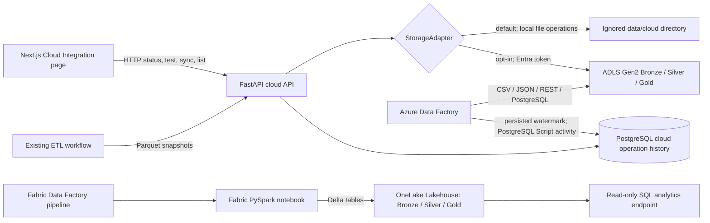

# DataFlow360 cloud architecture

## Components and trust boundaries

The local adapter is the default and does not contact Azure. Azure storage is
selected with `CLOUD_STORAGE_MODE=azure`; its account URL, file systems, and
Microsoft Entra identity come from environment configuration. A test operation
checks access but does not create containers. A successful local test is not
evidence of Azure connectivity. Likewise, entering Fabric workspace and
Lakehouse names only records configuration; no Fabric API or execution is
implemented in the local backend.

The current `/cloud/sync` action copies the actual Bronze, Silver, and Gold
Parquet snapshots produced by the existing ETL workflow. The adapter can store
and retrieve any supplied file, including CSV, JSON, and Parquet; Azure Data
Factory templates additionally provide CSV/JSON file and REST ingestion.
Operation history is persisted by `005_cloud_integration.sql`.

## Data flow

1. The existing ETL writes PostgreSQL medallion tables and Parquet snapshots.
2. The dashboard reads status/history from the backend. Its test and sync
   buttons call backend endpoints; they do not simulate success.
3. The storage adapter either writes files under `CLOUD_LOCAL_ROOT` or uses
   Azure Data Lake SDK clients authenticated by `DefaultAzureCredential`.
4. ADF authoring assets provide independent cloud ingestion patterns. They are
   not automatically invoked by the local Airflow DAG.
5. The Fabric notebook reads an uploaded input file from a Lakehouse, then
   materializes Delta Bronze, Silver, Gold, quarantine, and quality tables.

## Configuration and limits

- Local is the default execution mode. Local files under `data/cloud/` are
  ignored by Git.
- Azure mode requires pre-created `dataflow-bronze`, `dataflow-silver`, and
  `dataflow-gold` ADLS file systems and a valid Entra identity.
- The backend sync action currently mirrors only the three canonical Parquet
  snapshots. It is not a continuous replication service.
- ADF resources are deployable templates for an existing Data Factory; no
  factory, account, database, network, or Fabric capacity is provisioned here.
- No cloud provider, Fabric workspace, or paid resource was contacted or
  created for this implementation.
