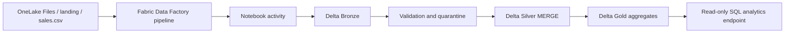

# Microsoft Fabric Lakehouse workflow

The project includes [`azure/fabric/dataflow360_medallion.ipynb`](../azure/fabric/dataflow360_medallion.ipynb),
a Fabric-compatible PySpark notebook. It uses OneLake Lakehouse Files for input
and Delta tables for Bronze, Silver, Gold, quarantine, and quality metrics.
Local PySpark execution is not equivalent to executing this notebook in a real
Fabric workspace. No Fabric tenant, workspace, capacity, pipeline, or notebook
run was available or used to verify it.



## Requirements

- A Microsoft Fabric-enabled tenant and workspace assigned to an appropriate
  Fabric capacity or trial. Workspace and capacity access depend on tenant
  policy and licensing.
- A Lakehouse attached as the notebook's default Lakehouse.
- Permission to create/run notebooks and write Delta tables in the Lakehouse.
- The DataFlow360 synthetic sales CSV. It is generated locally by
  `scripts/generate_synthetic_data.py`; generated scale data is ignored by Git.

## Import and run

1. From the repository root, generate the normal 50,000-record source:

   ```powershell
   python .\scripts\generate_synthetic_data.py --records 50000
   ```

2. Create a Fabric workspace and Lakehouse using your organization's approved
   account and capacity. These resources are not provisioned by this project.
3. Upload `data/sales_50000.csv` to the Lakehouse path
   `Files/landing/sales.csv`.
4. Import `azure/fabric/dataflow360_medallion.ipynb` into that workspace, attach
   the Lakehouse, and run all cells. The source path in the first code cell is
   `Files/landing/sales.csv`; change only if your Lakehouse path differs.
5. Confirm the cells report real run counts and that the Lakehouse contains
   `bronze_sales`, `silver_sales`, `gold_sales_daily`,
   `dataflow_quarantine`, and `dataflow_quality_runs`.
6. For orchestration, create a Fabric Data Factory pipeline in the workspace,
   add a Notebook activity referencing the imported notebook, select the
   Lakehouse environment, and run it manually first. Optionally add a Copy Data
   activity ahead of it to place a source into `Files/landing/`; configure the
   notebook activity to run only after the copy succeeds. Do not schedule until
   the source path, quality counts, and Delta merge results are reviewed.
7. Query the generated Delta tables from the Lakehouse SQL analytics endpoint.
   The endpoint is read-only and exposes Lakehouse Delta tables under `dbo`;
   use its generated connection details rather than assuming a local
   PostgreSQL connection.

## Notebook behavior

- **Bronze:** appends each input file with ingestion time and a unique run id.
- **Validation:** casts and validates required order/product/date/numeric
  fields, and defaults missing line number to `1` for the supplied generated
  dataset.
- **Grain:** deduplicates on `(order_id, line_number)`. Same order IDs with
  different line numbers remain distinct.
- **Silver:** uses Delta `MERGE` update/insert semantics, making a repeated
  source idempotent and allowing changed rows to propagate.
- **Quality:** records missing, malformed, invalid, and duplicate counts plus
  rejected records and reasons.
- **Gold:** recomputes date/region/category aggregates from Silver and merges
  them, removing stale aggregate groups when a changed row moves dimensions.

The input schema is anchored to the repository's synthetic generator:
`order_id`, `customer_id`, `customer_name`, `product_id`, `product`, `category`,
`supplier_id`, `region`, `order_date`, `quantity`, and `unit_price`. If a source
column is absent, update the notebook schema mapping rather than expecting
Spark to silently infer a different contract.

## Official references

- [Fabric Lakehouse overview](https://learn.microsoft.com/fabric/data-engineering/lakehouse-overview)
- [OneLake overview](https://learn.microsoft.com/fabric/onelake/onelake-overview)
- [Fabric notebooks](https://learn.microsoft.com/fabric/data-engineering/how-to-use-notebook)
- [Delta Lake in Fabric](https://learn.microsoft.com/fabric/data-engineering/lakehouse-and-delta-tables)
- [Lakehouse SQL analytics endpoint](https://learn.microsoft.com/fabric/data-engineering/lakehouse-sql-analytics-endpoint)
- [Fabric Data Factory notebook activity](https://learn.microsoft.com/fabric/data-factory/notebook-activity)

## Limitations

This notebook does not connect to the local PostgreSQL database, ADF, or an
existing Fabric workspace. It uses a Spark-compatible representation of the
current ETL checks. Fabric runtime behavior, the SQL endpoint, capacity
availability, and pipeline scheduling must all be verified in the target
workspace by its owner.
