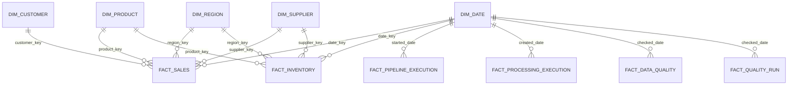

# Power BI semantic model

Use the PostgreSQL `bi` schema as the operational reporting layer and the
Gold PostgreSQL warehouse as the source of truth. Load each view as a separate
table and use the following display names.

| Power BI table | PostgreSQL relation | Grain / key |
|---|---|---|
| Fact Sales | `bi.fact_sales` | One row per `(order_id, line_number)`; sales line is the composite business key |
| Fact Inventory | `bi.fact_inventory` | One row per `(product_key, date_key)`; `inventory_key` is the row key |
| Fact Pipeline Execution | `bi.fact_pipeline_execution` | One row per `pipeline_run_id` |
| Fact Processing Execution | `bi.fact_processing_execution` | One row per `execution_id`; includes benchmark rows |
| Fact Data Quality | `bi.fact_data_quality` | One row per persisted result/rule and pipeline run |
| Fact Quality Run | `bi.fact_quality_run` | One row per `pipeline_run_id` quality summary |
| Dim Customer | `bi.dim_customer` | `customer_key` |
| Dim Product | `bi.dim_product` | `product_key`; category attributes are intentionally denormalized here |
| Dim Date | `bi.dim_date` | `date_key`; unique date is `full_date` |
| Dim Region | `bi.dim_region` | `region_key` |
| Dim Supplier | `bi.dim_supplier` | `supplier_key` |

Create one-to-many relationships from each dimension key to the matching fact
foreign key, with **single-direction filtering from dimension to fact**.
For execution facts, relate `Dim Date[full_date]` to the corresponding
date-only column (`started_date`, `created_date`, or `checked_date`). Avoid
connecting facts directly to each other or enabling bidirectional filters.
The model has no separate category table: category is a product attribute to
avoid an unnecessary snowflake.

Mark `Dim Date` as the date table using `full_date`. Sort `month_name` by
`month`; configure the hierarchy `year > quarter > month_name > full_date`.
Use an additional product hierarchy `category_name > product_name` and a
region hierarchy `region_name`.

The date dimension contains the calendar fields available in the warehouse.
Do not assume it extends beyond the dates actually present; use the actual
view values when setting the reporting period.

## Measure and calculation notes

- Revenue is the generated `quantity * unit_price` fact value. Cost, margin,
  and profit are not present and are intentionally not defined.
- `Total Orders` counts distinct `order_id`; sales line counting must use the
  `(order_id, line_number)` grain rather than order ID alone.
- Customer Lifetime Value is observed lifetime revenue in the loaded facts,
  not a forecast.
- Customer segmentation uses relative revenue rank bands (top 20%, middle
  60%, bottom 20%) and is a measure, not a persisted customer attribute.
- Inventory turnover is a unit-based proxy computed from quantity sold and
  average opening/closing stock. It is not cost-of-goods inventory turnover.
- Low stock means `closing_stock <= 25`, matching the current dbt
  `low_stock_products` model; it is not a supplier reorder-point field.
- Quality scores and rates are persisted as percentages on a 0–100 scale.
- Pipeline durations exclude runs without a finish timestamp. Processing
  throughput uses persisted input rows divided by persisted duration.
- DirectQuery, query folding, and relationship behavior must be confirmed in
  Power BI Desktop; this repository does not contain a PBIX/PBIP project.
